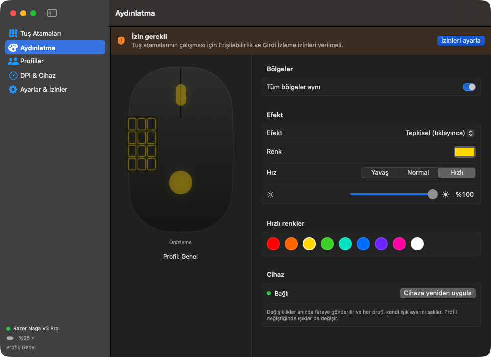

<p align="center">
  
</p>

<h1 align="center">NagaPandasticPro</h1>

<p align="center">Razer Naga V3 Pro için macOS özelleştirme uygulaması. Razer Synapse olmadan tuş atamaları, makrolar, profiller, DPI ve RGB ışık ayarları.</p>

## Ekran görüntüleri

<p align="center">
  
</p>

# NagaPandasticPro — Razer Naga V3 Pro için macOS özelleştirme uygulaması

Razer Synapse'in artık macOS'ta olmamasının yerini doldurmak için yazılmış, yerel (SwiftUI) bir uygulama.
Menü çubuğunda çalışır, ana penceresinden her şey ayarlanır.

## Özellikler

**Tuş atamaları:** 12 yan tuş, sol, sağ ve orta tık, geri/ileri ve "Tuş öğren" ile eklenen her tuş için:

| Eylem | Açıklama |
|---|---|
| Klavye tuşu / kısayol | Tek tuş ya da ⌘⇧4 gibi bir kombinasyon. Kaydet düğmesiyle, hazır listeden ya da elle seçilir |
| Makro | Tuş bas/bırak, metin, bekleme, tıklama, link ve uygulama adımlarından oluşan sıra. **Canlı kayıt** da yapılabilir |
| Metin yaz | Herhangi bir metni yazar (Türkçe karakter ve emoji dahil) |
| Uygulama aç | Bir uygulamayı tek tuşla açar |
| Web sitesi aç | Bir linki varsayılan tarayıcıda açar |
| Terminal komutu | zsh komutu çalıştırır |
| Medya / sistem | Oynat/duraklat, ileri, geri, ses, sessiz, parlaklık |
| Fare tıklaması / kaydırma | Sol, sağ, orta, geri, ileri tıklama; dört yöne kaydırma |
| DPI ayarla | Tuşa basınca DPI değişir (keskin nişancı modu) |
| Profil değiştir | Sonraki profile ya da belirli bir profile geçer |
| Hypershift | Bu tuş basılıyken ikinci katman devreye girer, böylece 12 tuşla 24 işlev yapılabilir |
| Devre dışı | Tuş hiçbir şey yapmaz |

Her eylem için tekrar davranışı seçilebilir: **tek sefer** (tuş basılı tutulursa kısayol da basılı kalır, oyunlar için uygundur), **basılı tuttukça tekrarla** ya da **aç/kapa**.

**Aydınlatma:** Logo, tekerlek ve yan tuş paneli ayrı ayrı ya da birlikte ayarlanabilir.
- Efektler: kapalı, sabit renk, nefes (tek renk, iki renk, rastgele), spektrum, dalga ←/→, tepkisel
- Her bölgenin kendi rengi, hızı ve parlaklığı vardır
- Canlı, animasyonlu önizleme gösterilir
- Her profil kendi ışık ayarını saklar

**Profiller:**
- İstediğiniz kadar profil oluşturabilir, çoğaltabilir, dışa ya da içe aktarabilirsiniz (JSON)
- Bir profili uygulamaya bağlayabilirsiniz. O uygulama öne gelince tuşlar, ışık ve DPI kendiliğinden değişir

**Cihaz:** Pil seviyesi ve şarj durumu, her profile ayrı DPI, oturum açılışında başlatma, Dock'ta gizleme seçeneği.

## Gereksinimler

- macOS 14 Sonoma veya sonrası (macOS 15 ve 26 dahil)
- Xcode 16 veya sonrası, ya da yalnızca Command Line Tools (`xcode-select --install`)
- Naga V3 Pro: USB kablosu ya da HyperSpeed alıcısı. Bluetooth'ta tuş ataması çalışır ama ışık, DPI ve pil çalışmayabilir.

## Derleme ve kurulum

```bash
cd NagaPandasticPro
./build-app.sh
```

```bash
cp -R build/NagaPandasticPro.app /Applications/
```

```bash
open /Applications/NagaPandasticPro.app
```

### İzinler (ilk açılışta)

**Sistem Ayarları → Gizlilik ve Güvenlik** bölümünde NagaPandasticPro için iki izin açılmalı:

1. **Erişilebilirlik:** tuşları yakalamak ve kısayol göndermek için
2. **Girdi İzleme:** basılan tuşun Naga'dan mı klavyeden mi geldiğini ayırt etmek için

İzinleri verdikten sonra uygulamayı yeniden başlatın (Ayarlar ekranında "Yeniden başlat" düğmesi var).

> **Önemli:** Ad-hoc imzayla her yeniden derlemede macOS uygulamayı yeni bir uygulama sayar ve izinleri yeniden ister.
> Bunu önlemek için sabit bir sertifikayla imzalayın:
> ```bash
> CODESIGN_IDENTITY="Apple Development: Adınız (XXXXXXXXXX)" ./build-app.sh
> ```
> Sertifika listesini `security find-identity -v -p codesigning` ile görebilirsiniz.

Naga ilk takıldığında macOS "Klavye Ayarı Yardımcısı" penceresini açabilir. Bu pencereyi kapatmanız yeterli.

## Nasıl çalışır?

- **Tuşlar:** Naga'nın yan tuşları sisteme normal klavye tuşu olarak `1 2 3 … 0 - =` gönderir. macOS bir tuşun hangi cihazdan geldiğini doğrudan söylemediği için NagaPandasticPro iki kaynağı birlikte dinler:
  `IOHIDManager` basmanın hangi cihazdan geldiğini, `CGEventTap` ise sisteme giden olayı görür. Olay Naga'dan geldiyse engellenir ve atanan eylem çalışır. Gerçek klavyenizdeki `1` tuşu etkilenmez.
- **Işık, DPI ve pil:** Razer'in 90 baytlık HID "feature report" protokolü kullanılır (OpenRazer ve OpenRGB projelerinin belgelediği protokol). Sürücü kurmak gerekmez.

## Bilinen sınırlar ve ipuçları

- Farenin üstündeki DPI tuşları ile tekerleğin sağa/sola eğilmesi donanımda işlenir ve şu an atanamaz. Atanabilir olanlar 12 yan tuş, sol, sağ ve orta tık, geri ve ileri tuşlarıdır.
- Yan panel 6 ya da 2 tuşlu panelle değiştirildiyse **Tuş Atamaları → Tuş öğren** ile tuşları tanıtın.
- Atanmış bir tuşla aynı kodu gönderen gerçek klavye tuşu (ör. `1`) çok küçük bir gecikmeyle (en fazla ~30 ms) iletilir. Atanmamış tuşlarda gecikme olmaz.
- Işık bölgesi kimlikleri: tekerlek `0x01`, logo `0x04`, yan panel `0x05`. Bir bölge yanıt vermezse bu değerler `Models.swift → LightZone.ledID` içinden değiştirilebilir.
- Desteklenen ürün kimlikleri `0x00A7` (kablolu) ve `0x00A8` (HyperSpeed). Adında "Naga" geçen diğer Razer cihazları da otomatik tanınır (`RazerProtocol.swift → RazerIDs`).
- Ayarlar `~/Library/Application Support/NagaPandasticPro/config.json` dosyasında saklanır.

## Proje yapısı

```
Sources/NagaPandasticPro/
  NagaPandasticProApp.swift     Uygulama girişi, menü çubuğu, ana pencere
  Models.swift           Tuş, eylem, makro, ışık ve profil veri modelleri
  AppModel.swift         Durum yönetimi, kayıt, izinler, otomatik profil
  InputEngine.swift      HID ve event tap eşleştirmesiyle tuş yakalama
  ActionRunner.swift     Kısayol, makro, metin, uygulama ve link eylemleri
  RazerProtocol.swift    Razer HID protokolü: ışık, DPI, pil
  HIDKeyMap.swift        HID ve macOS tuş kodu tabloları, tuş adları
  Views/                 SwiftUI ekranları
```

---
Bu proje Razer Inc. ile bağlantılı değildir. "Razer" ve "Naga" Razer Inc.'in ticari markalarıdır.
